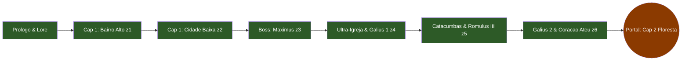

# 🔥 HELLSLAYER — Mapa de Conteúdo (MOC)

> [!abstract] Visão Geral do Projeto
> **HELLSLAYER** é um *boomer shooter* em primeira pessoa com estética PSX/retro-3D (Three.js, resolução interna 270p) onde **Nivaldo Cruz** — um pedreiro de 2,30m e 450kg — tem **3 dias** para atravessar o Inferno, destruir o **Necro-Cristal** e matar o corrompido **Super-Papa Testus MMDCLXVI** antes que a Terra seja totalmente contaminada.

---

## 🧭 Navegação do Plano

### 1. Avaliação Profunda & Estado Atual
- [[Avaliacao de Game Design e Mercado]] — Análise crítica da ideia, pilares, tom, riscos e posicionamento.
- [[Auditoria Tecnica do Projeto Atual (Beta 1)]] — Raio-X completo do código já existente (`js/`, `index.html`, `style.css`).

### 2. Lore, Universo & Personagens
- [[Biblia do Universo e Cronologia]] — Ano 666 D.S.C., os 3 dias de prazo, o Portal Maligno e o Necro-Cristal.
- [[Personagens e Faccoes]] — Nivaldo Cruz, Romulus I & III, Maximus, Galius, Baphomet, Belzebub, Satanás e Testus MMDCLXVI.

### 3. Sistemas de Game Design
- [[Core Loop, Movimento e Super-Fe]] — Movimentação, Dash, Style Rank, economia de Vida/Sangue e modo Super-Fé.
- [[Arsenal e Balanceamento]] — As 7 armas do Capítulo 1 + upgrades e armas futuras.
- [[Bestiario e Bosses]] — Inimigos atuais, bosses do Cap. 1 e novos inimigos/bosses até o final.

### 4. Campanha & Level Design
- [[Capitulo 1 - Nos Portoes do Inferno (Status Beta 1)]] — Comparativo entre a lore original e o que já está implementado.
- [[Capitulo 2 - A Floresta Infernal (Proximo)]] — Design completo da continuação direta do gancho da Beta 1.
- [[Capitulos 3 e 4 - Arco Final (3 Dias)]] — Fechamento da campanha (Dias 2 e 3) até Testus MMDCLXVI.

### 5. Engenharia & Produção
- [[Plano de Refatoracao Tecnica]] — Como preparar a base Three.js atual para múltiplos capítulos.
- [[Roadmap de Producao (Fases e Milestones)]] — Plano de execução faseado com checklists práticos.

---

## 📊 Status Atual do Projeto (Beta 1)

- **Legenda:** Verde = Já jogável na Beta 1 (`index.html`) | Laranja pontilhado = Próximo marco de desenvolvimento.

---

## ✅ Checklist Macro do Projeto

- [x] Protótipo jogável completo do **Capítulo 1** (Zonas 1 a 6 + Catacumbas + 2 Bosses)
- [x] Pipeline visual PSX (270p, texturas procedurais, modelos voxel/box em Three.js)
- [x] Sistema de áudio procedural (Web Audio API com intensidade dinâmica + controle de volume)
- [x] 7 armas implementadas com viewmodels e **ataques secundários no botão direito** (Parry, Tijolo, Pedrada, Ceifa, Onda Sísmica, Recall, Rajada)
- [x] Refinamento crítico de *game feel* (Hitstop reforçado, Parry de projétil, Queda de 450 kg, Coyote Time, física de plataformas `y`, feedback de imunidade do Galius, anti-softlock no radar)
- [x] Persistência (`localStorage`) para sensibilidade, volume e recordes + gatilhos declarativos (`World.triggers`)
- [ ] Extração completa de múltiplos capítulos independentes (`chapters/ch2.js`)
- [ ] Desenvolvimento do **Capítulo 2 — A Floresta Infernal**
- [ ] Desenvolvimento dos **Capítulos 3 e 4** (Baphomet, Belzebub, Satanás, Testus MMDCLXVI)
