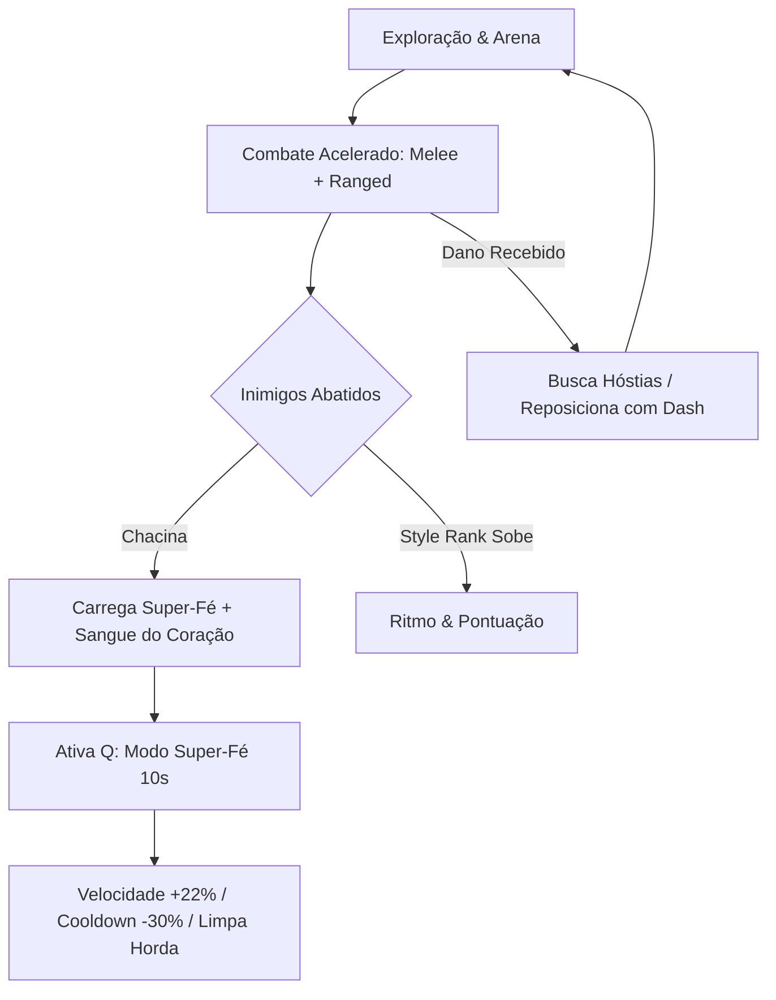

# ⚡ Core Loop, Movimento e Super-Fé

## 1. O Loop Principal de Combate

---

## 2. Movimentação (Estado Atual vs. Evolução)

### Já Implementado na Beta 1 (`game.js` / `game2.js`)
- **Velocidade base:** `8.2 u/s` (aumenta para `10 u/s` durante Super-Fé).
- **Dash (`Shift`):** Impulso direcional rápido com barra dedicada no HUD e cooldown curto.
- **Pulo (`Espaço`):** Pulo simples para desviar de projéteis e atravessar obstáculos baixos.
- **FOV Kick & Bobbing:** Feedback visual de velocidade e passos pesados de um gigante de 450kg.

### Melhorias Recomendadas (Game Feel)
- [ ] **Ground Slam (Queda de 450 kg):** Apertar `Ctrl` ou `C` no ar faz Nivaldo despencar com o peso de 450kg, causando dano em área e jogando inimigos leves para cima. Combina perfeitamente com a lore física do personagem!
- [ ] **Coyote Time & Jump Buffering:** Pequena tolerância ao pular de bordas (essencial para o Cap. 2 se houver plataformas/ravinas).
- [ ] **Hitstop (Congelamento de Impacto):** Pausa de `30–50ms` ao acertar golpes críticos com o Martelo de Demolição, Foice ou Sacra Cruz. Dá sensação real de peso.

---

## 3. Sistema de Super-Fé (`Q`)

- **Como carrega:** Causando dano e eliminando demônios (`addFaith`).
- **Efeito Atual (10 segundos):**
  - Velocidade de movimento sobe de `8.2` para `10`.
  - Cooldown das armas reduzido em 30% (`cdMul = 0.7`).
  - FOV aumenta `+6°`, luz do jogador fica dourada (`0xffd860`) e filtro dourado no HUD (`#faithTint`).
- **Evolução Sugerida para Capítulos 2+:**
  - [ ] **Regeneração Leve:** Recuperar `2–3 HP/s` enquanto Super-Fé estiver ativa, recompensando o jogador por usar ofensivamente quando estiver com pouca vida.
  - [ ] **Dano Sagrado Bônus:** Ataques durante Super-Fé quebram armaduras/escudos de inimigos pesados mais rápido.

---

## 4. Style Rank & Economia de Recursos

- **Style Rank (`styleRank` / `styleBar`):** Mede agressividade contínua sem tomar dano.
  - *Sugestão de nomes temáticos BR/Católicos para os ranks:* `PECADO` -> `PENITÊNCIA` -> `DEVOÇÃO` -> `MILAGRE` -> `SANTA CHACINA` -> `SUPER-FÉ`.
- **Economia Tripla:**
  1. **Hóstias (Vida):** Pickups fixos e eventuais drops de inimigos maiores.
  2. **Pedras (Funda):** Pickups no mapa (max 80).
  3. **Sangue (Coração Ateu):** Recarregado pela **chacina** (abates corpo-a-corpo ou pickups `vial`), criando sinergia direta entre usar o Martelo/Foice e disparar com o Coração.

---

## 5. Notas Relacionadas
- [[Arsenal e Balanceamento]]
- [[Bestiario e Bosses]]
- [[Avaliacao de Game Design e Mercado]]
