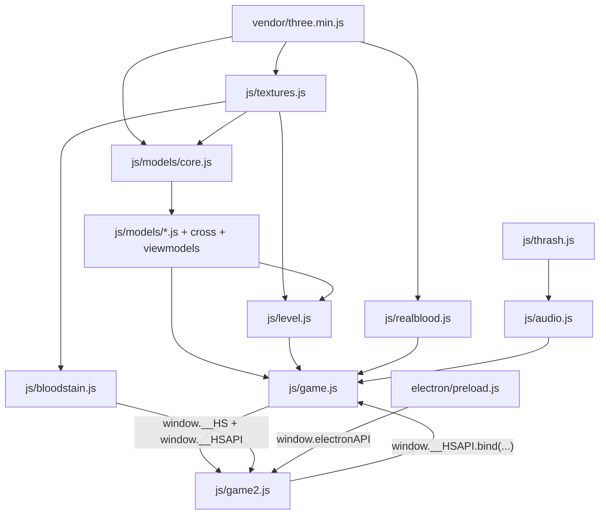

# 🔗 Mapa de Módulos, Ordem de Carregamento e Globais

> O projeto **não utiliza bundler**. Toda comunicação entre arquivos acontece via variáveis globais carregadas em sequência no final de `index.html` (`L867–L888`). Quebrar essa ordem causa `ReferenceError` no boot.

---

## 1. Ordem Exata de `<script>` em `index.html`

| # | Arquivo | Linhas | Globais / APIs que Expõe | Consome |
| :---: | :--- | :---: | :--- | :--- |
| 1 | `vendor/three.min.js` | — | `THREE` | — |
| 2 | `js/textures.js` | ~276 | `PSX_RES`, `psx(mat)`, `TX` (`get`, `mat`, `skyTexture`, `setFilter`) | `THREE` |
| 3 | `js/thrash.js` | ~650 | `window.ThrashMusic` (`init`, `sched`, `setTrack`, `getTrack`, `listTracks`, `resetSong`, `isOnlineMidiReady`) | WebAudio API, WebAudioFont (CDN opcional c/ fallback) |
| 4 | `js/audio.js` | ~383 | `SFX` (`init`, `play`, `setIntensity`, `setTrack`, `setCutscene`, `setVolume`, `setMusicVolume`, `setGoreVolume`, `setScreams`, `setMuted`, `toggleMute`) | `window.ThrashMusic`, `soundeffect/*` |
| 5 | `js/realblood.js` | ~1.016 | `window.RealBlood` (emissores de gotas, atlas de manchas, render-target de fluxo GPU) | `THREE`, `World` (em runtime) |
| 6 | `js/models/core.js` | ~704 | `BX`, `MT`, `part`, `limb`, `bioHeart`, `humanoid`, `buildRosary`, `heartPulse`, `BUILD`, `bakeRig`, `cloneBakedRig`, `buildBakedCached` | `THREE`, `psx` |
| 7 | `js/models/cross.js` | ~155 | `buildPapalCrossMesh`, `buildThrownCross` | `THREE`, `BX`, `MT`, `part` |
| 8 | `js/models/diabrete.js` | ~203 | `BUILD.diabrete` | `core.js` |
| 9 | `js/models/padre.js` | ~216 | `BUILD.padre` | `core.js` |
| 10 | `js/models/nivaldo.js` | ~437 | `BUILD.nivaldo` | `core.js` |
| 11 | `js/models/galius.js` | ~109 | `BUILD.galius` | `core.js` |
| 12 | `js/models/maximus.js` | ~222 | `BUILD.maximus` | `core.js` |
| 13 | `js/models/campones.js` | ~162 | `BUILD.campones` | `core.js` |
| 14 | `js/models/gargula.js` | ~272 | `BUILD.gargula` | `core.js` |
| 15 | `js/models/guarda.js` | ~177 | `BUILD.guarda` | `core.js` |
| 16 | `js/models/demonio.js` | ~221 | `BUILD.demonio` | `core.js` |
| 17 | `js/models/camponesVivo.js` | ~182 | `BUILD.camponesVivo` | `core.js` |
| 18 | `js/models/viewmodels.js` | ~270 | `buildViewmodels` | `core.js`, `cross.js` |
| 19 | `js/bloodstain.js` | ~299 | `window.BloodStain` (`init`, `addBlood`, `applyToCross`, `update`, `reset`) | `THREE`, `psx` |
| 20 | `js/level.js` | ~2.456 | `CHUNK_SIZE`, `World`, `ENV`, `getGroundY`, `setTerrain`, `addPad`, `envAt`, `openGate`, `closeGateInstant`, `unlockExitGate`, `openAltar`, `closeAltarInstant`, `SPAWNS`, `PICKUPS`, `PEASANTS`, `MAP_BUILDERS`, `buildMap`, `buildWorld`, `updateWorld` | `THREE`, `TX`, `psx`, `MT`, `BX`, `BUILD`, `buildPapalCrossMesh` |
| 21 | `js/game.js` | ~4.528 | `window.__HS`, `window.__HSAPI` | `THREE`, `TX`, `SFX`, `RealBlood`, `BUILD`, `buildViewmodels`, `World`, `ENV`, `SPAWNS`, `PEASANTS` |
| 22 | `js/game2.js` | ~7.621 | `window.__game` (handle de debug/automação) | `window.__HS`, `window.__HSAPI`, `World`, `SFX`, `TX`, `BUILD`, `BloodStain`, `RealBlood`, `window.electronAPI` |

> [!warning] Arquivo fora de `index.html`
> `js/nivaldo.js` (~722 linhas) **não** é carregado pelo jogo principal (`index.html`). Ele é usado apenas pelo visualizador isolado `viewer.html` (ver [Dívidas Técnicas e Armadilhas](../04-Engenharia-e-Operacao/Dividas-Tecnicas-e-Armadilhas.md)).

---

## 2. Grafo de Dependências



---

## 3. Contratos das Pontes Globais

### `window.__HS` (Estado Compartilhado — `js/game.js:4683`)
```js
{ P, S, WEAPONS, enemies, peasants, scene, camera, renderer, parts, gibs, decals, projs, rings, vmScene, vmCam, VMS }
```
- `P`: estado físico e de combate do jogador (posição, velocidade, HP, armadura, fé, dash, kick, slam, grab, combos).
- `S`: estado global de sessão/progressão (stage, difficulty, kills, style, checkpoint, boss, cross, cutscene, rooms).

### `window.__HSAPI` (API do Motor — `js/game.js:4684–4698`)
Agrupa funções de:
- **Colisão / Raycast:** `resolveCircle`, `groundAt`, `ceilingAt`, `pointInWall`, `los`, `clipCameraRay`.
- **Combate / Inimigos:** `spawnEnemy`, `removeEnemy`, `clearRoomEnemies`, `aliveInRoom`, `hurtPlayer`, `dmgEnemy`, `killEnemy`, `addFaith`, `findHitPart`, `findHitPartRay`, `updateEnemy`, `setGloryGlow`, `flushGloryQueue`, `bisectEnemy`, `decapEnemy`, `smashHeadEnemy`, `launchKickedEnemy`, `deformGaliusHit`.
- **Gore / Limbos / Partículas:** `burst`, `spawnRing`, `spawnProj`, `updateParts`, `updateRings`, `updateProjs`, `makeNodeProp`, `makeEnemyHalves`, `severLimb`, `addCorpsePart`, `pushGib`, `evictOldestGib`, `bloodSpurt`, `spawnBloodDecal`, `spawnGore`, `clearParts`, `clearProjs`.
- **Camponeses:** `peasants`, `spawnPeasant`, `removePeasant`, `clearPeasants`, `spawnMapPeasants`, `hitPeasant`, `launchPeasantRagdoll`, `rescuePeasant`, `updatePeasant`, `updatePeasantLabels`.
- **Qualidade / Render:** `setBloodMode`, `setGoreDuration`, `setGoreImpact`, `setParticleScale`, `setGoreQuality`, `setDismember`, `setBleedJoints`, `setGibDrips`, `setBlobShadows`, `setEnemyCullDist`, `setPeasantLabels`, `setInternalHeight`, `setPsxJitter`, `setPixelatedCanvas`, `setSSAO`, `setRenderDistance`, `syncRenderDistanceEntities`, `resize`, `renderScene`.
- **Injeção reversa (`bind`):** `game2.js` registra `{ die, say, quip, spawnPickup, startImpale, startGaliusBite }` em `game.js`.

### `window.__game` (Debug / Console — `js/game2.js:7849`)
Expõe `start`, `tick`, `tickTitle`, `render`, `P`, `S`, `WEAPONS`, `enemies`, `peasants`, `World`, `ROOMS`, `startRoom`, `devClear`, `pickups`, `say`, `selectWeapon`, `attack`, `altAttack`, `respawn`, `SAVE`, `QUALITY_PRESETS`, `applyPreset`, `applySettingsToEngine`, `applyRenderDistanceChange`, `setMouse`, `curW`.

### `window.electronAPI` (`electron/preload.js`)
Expõe `{ isElectron: true, quit: () => ipcRenderer.send('app:quit') }`. Sempre cheque `window.electronAPI` antes de chamar `quit()` para manter compatibilidade com navegador puro.

---

## 4. Notas Relacionadas
- [Regras para IAs](Regras-para-IAs.md)
- [Índice de Símbolos](Indice-de-Simbolos.md)
- [Visão Geral e Stack](../01-Arquitetura/Visao-Geral-e-Stack.md)
