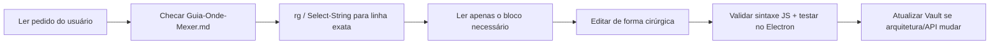

# 🤖 Regras para IAs — Protocolo Universal de Trabalho

> Este guia foi projetado para que **qualquer agente de IA** (Claude Code, Gemini/Antigravity, Codex, Cursor, Windsurf, Copilot) trabalhe com máxima precisão, mínimo gasto de tokens e zero regressões no projeto **HELLSLAYER (`CABRUNCO`)**.

---

## 1. Regras de Ouro (Economia de Tokens & Precisão)

1. **NUNCA leia arquivos grandes inteiros.**
   - `js/game2.js` (~7.621 linhas), `js/game.js` (~4.528 linhas), `js/level.js` (~2.456 linhas), `js/realblood.js` (~1.016 linhas), `style.css` (~1.039 linhas) e `index.html` (~890 linhas) **não devem** ser carregados integralmente.
2. **Consulte o Vault → Busque com grep/rg → Leia apenas o bloco exato.**
   - Use [Guia: Onde Mexer](Guia-Onde-Mexer.md) e [Índice de Símbolos](Indice-de-Simbolos.md) primeiro.
   - Depois confirme a linha atual com `rg -n "<termo>" js/` ou `Select-String` e leia janelas de ~50–150 linhas.
3. **Ignore pastas/binários pesados em buscas:**
   - `node_modules/`, `dist/`, `.git/`, `.obsidian/`, `HELLSLAYER.exe`, `cinzel.zip`, `assets/*.png`, `fonts/`, `soundeffect/`.
4. **Sem bundler e sem ES Modules (`import`/`export`):**
   - O jogo roda via tags `<script>` em `index.html` dentro do Electron (ou navegador).
   - **Nunca** introduza `import`/`export`, `require()` no renderer ou TypeScript sem pedido explícito.
   - Novos scripts precisam ser registrados em `index.html` na ordem correta de dependência (ver [Mapa de Módulos e Globais](Mapa-de-Modulos-e-Globais.md)).
5. **Respeite o idioma e o tom do projeto:**
   - UI, textos de lore, quips e comentários de gameplay são em **Português do Brasil (pt-BR)**, tom *"sincerão épico"* (pedreiro devoto + horror PSX).
   - Nomes de funções/variáveis/IDs seguem o padrão existente (majoritariamente inglês técnico, com alguns nomes de domínio em PT-BR como `campones`, `diabrete`, `padre`, `guarda`, `gargula`, `demonio`).

---

## 2. Convenções Críticas do Motor (Não Quebre!)

| Convenção | Regra Exata | Onde Impacta |
| :--- | :--- | :--- |
| **Sistema de Coordenadas** | `Y` = altura (para cima), **`-Z` = frente** (`yaw = 0` olha para `-Z`), `X` = esquerda/direita. | `level.js`, `game.js`, `game2.js` |
| **Caixas / Salas (`hall`, `wbox`)** | Sempre `x1 < x2` e `z1 < z2`. | `js/level.js` |
| **Materiais PSX** | Novos materiais devem passar por `psx(mat)` ou `MT(color, opts)` para receber o vertex snap/jitter PSX. | `js/textures.js`, `js/models/core.js` |
| **Modelos 3D e Hierarquia de Juntas** | Rigs humanoides/inimigos/Nivaldo dependem de nomes exatos de juntas (`head`, `torso`, `armL`, `armR`, `legL`, `legR`, etc.) usadas em `animEnemy`, `initEnemyLimbs` e `updateNivaldo3P`. | `js/models/*`, `js/game.js`, `js/game2.js` |
| **Baking de Rigs (`bakeRig`)** | Modelos em `js/models/*` passam por `buildBakedCached(...)` para reduzir draw calls. Alterar materiais ou nós dinâmicos exige cuidado com `userData` (ex.: `noBake`, `isArm`). | `js/models/core.js`, `js/bloodstain.js` |
| **Ponte `game.js` ↔ `game2.js`** | `game.js` expõe `window.__HS` e `window.__HSAPI`. Funções definidas só em `game2.js` são injetadas via `window.__HSAPI.bind({...})`. | `js/game.js` (final), `js/game2.js` (topo) |
| **Reuso de Vetores (Zero GC no Loop)** | Funções chamadas a 60 FPS (`updateEnemy`, `updatePlayer`, `updateParts`, `findHitPartRay`) reutilizam scratch `THREE.Vector3`/`Box3`/`Matrix4` para evitar travadas de Garbage Collection. | `js/game.js`, `js/game2.js`, `js/realblood.js` |
| **Debug & Cheats (Dev)** | `F1` Arsenal completo · `F2` Modo Deus · `F3` Limpar sala atual · `window.__game` no DevTools. | `js/game2.js` |

---

## 3. Fluxo Recomendado por Tarefa

### Checklist Mínimo Pós-Edição
1. **Sintaxe JS válida:** rode `node --check js/<arquivo>.js` em todo arquivo alterado (rápido, funciona sem abrir janela).
2. **Checar dependências cruzadas:**
   - Mudou `WEAPONS`? Verifique `VMS` (`js/models/viewmodels.js`), `bloodstain.js` (`state.weapons`), `drawWeaponSlotIcon`, `updateVM` e `EPISODES.data.owned`.
   - Mudou `ETYPES`? Verifique `BUILD.<model>`, `SPAWNS`, `initEnemyLimbs`, `animEnemy` e `updateEnemy`.
   - Mudou `ROOMS` ou `MAP_BUILDERS`? Verifique `SPAWNS`, `PICKUPS`, `PEASANTS`, `EPISODES`, `ThrashMusic` (`track`) e `makeExitGate`.
   - Mudou opções/keybinds? Verifique `index.html`, `DEFAULT_SETTINGS`/`DEFAULT_BINDS`, `QUALITY_PRESETS`, `syncSettingsUI`, `bindOpt` e `applySettingsToEngine`.
3. **Atualização do Vault:** se criar um novo arquivo JS, mapa, arma, inimigo ou global, atualize o respectivo documento em `vault-hellslayer/` na mesma entrega.

---

## 4. Documentos Relacionados
- [Mapa de Módulos e Globais](Mapa-de-Modulos-e-Globais.md)
- [Índice de Símbolos](Indice-de-Simbolos.md)
- [Guia: Onde Mexer](Guia-Onde-Mexer.md)
- [Dívidas Técnicas e Armadilhas](../04-Engenharia-e-Operacao/Dividas-Tecnicas-e-Armadilhas.md)
