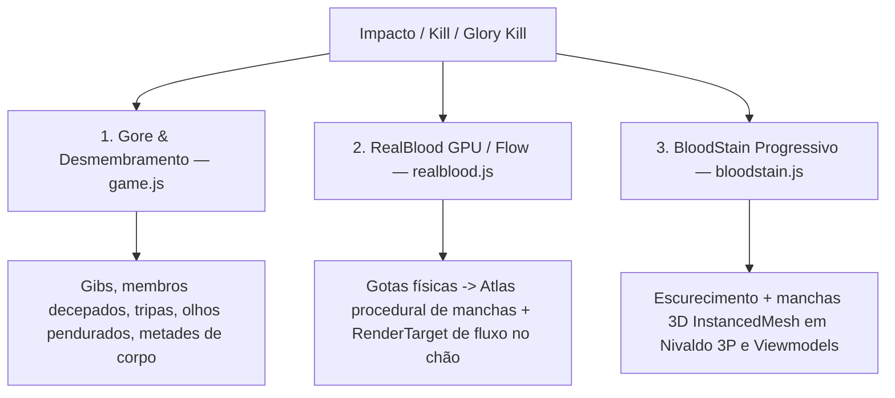

# 🩸 Sistema de Sangue, Gore e Desmembramento

O gore é um dos principais pilares técnicos e estéticos de **HELLSLAYER** e opera em **3 camadas independentes e coordenadas**:

---

## 1. Camada 1 — Desmembramento, Gibs e Dano Visual (`js/game.js`)

### Hitboxes por Parte do Corpo (`L1554–1672`)
- `PART_ORDER = ['head', 'armL', 'armR', 'legL', 'legR', 'wingL', 'wingR', 'torso']`
- `initEnemyLimbs(e)` registra cada junta do rig do inimigo com tamanho da caixa e metadados de coto (`stumpSize`).
- `findHitPart(e, pt, rad)` e `findHitPartRay(e, origin, dir, pad, opts)` determinam **exatamente** qual parte foi atingida por melee, projétil ou raycast.

### Dano Visual Progressivo & Mutilação (`L1673–2163`)
- **Desmembramento (`severLimb`):** destaca o membro, spawna `spawnSeveredLimbGib`, cria coto sangrando (se `bleedJointsEnabled`) e pode matar ou enfraquecer o inimigo.
- **Bisseção & Execuções:** `makeEnemyHalves` + `addSplitTorsoAnatomy` (costelas, coluna, órgãos expostos), `bisectEnemy`, `decapEnemy`, `smashHeadEnemy`.
- **Dano anatômico progressivo (`updateEnemyVisualDamage`):**
  - Cabeça (`damageHeadVisual`): ferimentos, mandíbula, `attachDanglingEye` (olho pendurado).
  - Torso (`damageTorsoVisual`): rasgos de carne e `attachGutsSpill` (tripas saindo do abdômen).
  - Membros (`damageLimbVisual`): cortes e exposição óssea.
  - Galius (`deformGaliusHit`): deformação específica no boss gigante.
- **Partículas, Decals & Gibs (`L722–1420`):**
  - `burst`, `bloodSpurt`, `bloodDrip`, `spawnGore`, `pushGib`, `spawnBloodDecal`, `addCorpsePart`.
  - Controle de memória via `evictOldestGib`, `evictDecalsFor` e caps dinâmicos ajustados por `setGoreQuality`, `setGoreDuration`, `setParticleScale`, `setGoreImpact`.

---

## 2. Camada 2 — `window.RealBlood` (`js/realblood.js` — ~1.050 linhas)

Ativo quando `bloodMode === 'realistic'` (`realBloodOn()` em `js/game.js:981`). Alternável no menu de opções para modo clássico (decals simples).

- **Gotas e Emissores (`L192–370`):** `emitDrop`, `updateEmitters`, `land(i)` com física balística, gotas filhas (`isChild`) e detecção de superfície via `bloodSurfaceY`/`bloodBlockedAt` (`game.js:879–901`).
- **Atlas Procedural de Manchas (`L388–629`):** `buildStainAtlas` gera manchas orgânicas usando value noise (`vnoise`) e `initStains` instancia respingos orientados pela direção/velocidade do impacto (`spawnRealStain`).
- **Mapa de Fluxo em GPU (`L777–1050`):** `initMap`, `flushSplats`, `flowStep`, `startJob`/`stepJob`/`finishJob`, `mapUpdate` simulam sangue escorrendo e espalhando no chão com orçamento de tempo (`budgetMs`) por frame para não derrubar o FPS.

---

## 3. Camada 3 — `window.BloodStain` (`js/bloodstain.js` — ~337 linhas)

Sistema de **sangue progressivo acumulado no protagonista e nas armas**:
- **Inicialização:** `BloodStain.init(nivaldo3P, VMS)` varre o modelo 3P de Nivaldo e todos os viewmodels de 1ª pessoa (`prepareTarget`), separando meshes de braço (`userData.isArm`) vs. arma e pré-alocando manchas 3D em `InstancedMesh` (`UNIT_BOX` + `SPLAT_MAT` com `instanceColor`).
- **Acúmulo:** `BloodStain.addBlood(bodyAmt, weaponId, weaponAmt)` aumenta gradualmente `state.body` e `state.weapons[id]` (`fists`, `hammer`, `sling`, `scythe`, `demo`, `cross`, `heart`, `kick`) — escurecendo a cor base dos materiais e revelando manchas 3D determinísticas (`hashSeed`).
- **Cruz Arremessada:** `BloodStain.applyToCross(mesh)` sincroniza o nível de sangue da Sacra Cruz Papal quando arremessada.
- **Decaimento / Reset:** `BloodStain.update(dt, moveAmt)` seca/limpa gradualmente após período de graça (`grace`); `BloodStain.reset()` limpa tudo ao reiniciar/morrer.

---

## 4. Opções de Gore Expostas ao Jogador
Configuradas na aba **Gore** do `#optionsModal` (`index.html:416`) e aplicadas em `applySettingsToEngine`:
- `bloodMode` (`realistic` / `classic`)
- `goreQuality` (`min` → `ultra`)
- `goreDur` (2s a infinito `61`)
- `particleScale`, `goreImpact`
- Toggles: `dismember`, `bleedJoints`, `gibDrips`

---

## Notas Relacionadas
- [Renderização PSX e Performance](Renderizacao-PSX-e-Performance.md)
- [Combate, Armas e Controles](../02-Gameplay-e-Sistemas/Combate-Armas-e-Controles.md)
- [Modelos 3D e Animação](../02-Gameplay-e-Sistemas/Modelos-3D-e-Animacao.md)
