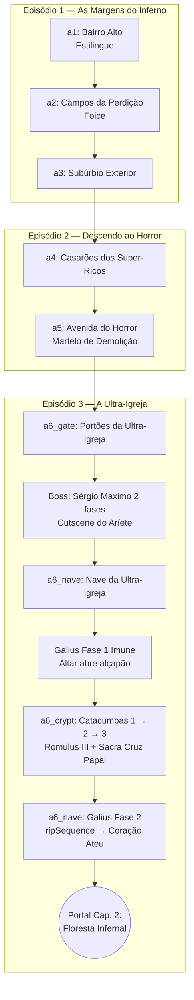

# 🗺️ Mapas, Episódios e Progressão (Capítulo 1 — Beta 1)

Na Beta 1, o Capítulo 1 (*Nos Portões do Inferno*) é dividido em **3 Episódios selecionáveis**, **8 Mapas carregados sob demanda (`MAP_BUILDERS`)** e **13 Salas/Encontros (`ROOMS`)**.

---

## 1. Fluxograma da Campanha Jogável (Beta 1)

---

## 2. Mapa Técnico: Episódios × Mapas × `ROOMS` × Trilhas

| Episódio (`EPISODES`) | Map ID (`level.js`) | Builder (`level.js`) | Room ID(s) (`game2.js:3895`) | Track (`thrash.js`) | Evento / Saída |
| :--- | :--- | :--- | :--- | :--- | :--- |
| **Ep. 1:** Às Margens do Inferno | `a1` | `buildMapA1` | `a1` (Bairro Alto) | `ep1_a1` | `unlockExitGate()` → `a2` |
| **Ep. 1:** Às Margens do Inferno | `a2` | `buildMapA2` | `a2` (Campos da Perdição) | `ep1_a2` | `unlockExitGate()` → `a3` |
| **Ep. 1:** Às Margens do Inferno | `a3` | `buildMapA3` | `a3` (Subúrbio Exterior) | `ep1_a3` | `unlockExitGate()` → `a4` |
| **Ep. 2:** Descendo ao Horror | `a4` | `buildMapA4` | `a4` (Casarões dos Super-Ricos) | `ep2_a1` | `unlockExitGate()` → `a5` |
| **Ep. 2:** Descendo ao Horror | `a5` | `buildMapA5` | `a5` (Avenida do Horror) | `ep2_a2` | `unlockExitGate()` → `a6_gate` |
| **Ep. 3:** A Ultra-Igreja | `a6_gate` | `buildMapA6Gate` | `a6_gate` → `a6_maximus` | `ep3_gate` → `ep3_maximus` | `spawnMaximus` → `maximusDead` → `a6_nave` |
| **Ep. 3:** A Ultra-Igreja | `a6_nave` | `buildMapA6Nave` | `a6_nave` → `a6_galius1` / `a6_galius2` | `ep3_nave` → `ep3_galius` | `galiusEvent` → `goCrypt` / `ripSequence` → `endGame` |
| **Ep. 3:** A Ultra-Igreja | `a6_crypt` | `buildMapA6Crypt` | `a6_crypt1` → `a6_crypt2` → `a6_crypt3` | `ep3_crypt` | Portões `g_c1`/`g_c2`/`g_c3` → `tombSequence` → volta `a6_nave` |

---

## 3. Como um Mapa é Construído e Carregado

### Pipeline de `buildMap(mapId)` (`js/level.js:2676`)
1. Libera o mapa anterior com `disposeWorldTree(World.group)` e limpa `colliders`, `dynamicColliders`, `colliderGrid`, `triggers`, `gates`, `flames`, `pillars`, `chunks`.
2. Executa `MAP_BUILDERS[mapId]()` (`buildMapA1`..`buildMapA6Crypt`), que usa:
   - `setTerrain` / `addPad` + `wterrain` / `flushTerrain`
   - `wbox`, `wpillar`, `wfloor`, `wceil`, `hall`, `house` (com `populateHouseFurniture`, `addHouseWindow`, `gablePrismGeo`), `populateCrops`, `deadTree`, `fountain`, `flame` (`flushFlames`), `makeGate`, `makeExitGate`, `addSkyPortal`, `addDistantChurch`, `addOuterHills`.
3. Chama `mergeStaticChunks()` para fundir geometrias estáticas por chunk 16×16.
4. Atualiza visibilidade de chunks ao redor da posição inicial (`World.updateChunks`).

### Pipeline de `loadMap(mapId, opts)` (`js/game2.js:3995`)
1. Limpa entidades da sessão anterior (`clearRoomEnemies`, `clearPeasants`, `clearPickups`, `clearParts`, `clearProjs`).
2. Chama `buildMap(mapId)`.
3. Spawna pickups (`spawnMapPickups(mapId)` via `PICKUPS`) e camponeses (`spawnMapPeasants(mapId)` via `PEASANTS`).
4. Posiciona jogador/checkpoint, aplica `ENV` / iluminação / fog (`applyLightingProfile`) e inicia a sala (`startRoom(roomId)`), que lê `SPAWNS[roomId]` e aciona `SFX.setTrack(room.track)`.
5. Entre áreas de campanha, exibe `#levelComplete` (`showLevelComplete` / `finishLevelComplete`) com cálculo de Kills %, Estilo %, Tempo e Rank Final.

---

## 4. Tabelas de Dados em `js/level.js`
- **`SPAWNS` (`L2281`):** inimigos por `roomId` (`[type, x, z]` ou objetos com coordenadas e variação).
- **`PICKUPS` (`L2418`):** armas, munições (`rocks`, `blood`), hóstias (`hp`) e armadura por `mapId`.
- **`PEASANTS` (`L2462`):** camponeses aliados por `mapId` (com variantes visuais).
- **`World.triggers` (`L22`):** caixas/zonas declarativas verificadas em `updateEvents(dt)` (`js/game2.js:5561`).

---

## Notas Relacionadas
- [Visão de Campanha (Cap. 1–4)](../03-Lore-e-Design/Visao-de-Campanha-Cap1-a-Cap4.md)
- [Áudio e Thrash Metal](../01-Arquitetura/Audio-e-Thrash-Metal.md)
- [Playbooks de Tarefas](../04-Engenharia-e-Operacao/Playbooks-de-Tarefas.md)
