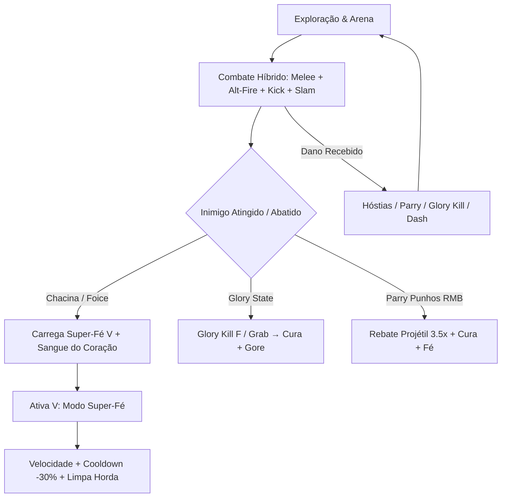

# ⚖️ Pilares de Design, Core Loop e Balanceamento

## 1. Pilares Criativos (Identidade de HELLSLAYER)
1. **Identidade Única ("Pedreiro Devoto vs. Inferno"):** mistura ferramentas de obra (Martelo, Demolição, Estilingue/Tijolo) com relíquias sagradas (Sacra Cruz Papal) e gore profano (Coração Ateu).
2. **Estética PSX Autêntica e Leve:** baixa resolução + vertex snapping + texturas procedurais + Thrash Metal acelerado.
3. **Combate Híbrido Visceral (Melee + Ranged + Execuções):** inspirado em *DOOM Eternal* + *Ultrakill* + *DUSK* — agressividade gera recursos (Sangue, Super-Fé, cura via Glory Kill/Parry).

---

## 2. Core Loop de Combate

---

## 3. Sinergias de Arsenal & Economia Tripla

### Sinergia Central ("Reboco e Sangria")
- **Punhos (RMB):** Parry de projéteis (utilidade permanente do Slot 1 do início ao fim do jogo).
- **Martelo de Obras (RMB):** Tijolo sem munição para anti-aéreo/médio alcance.
- **Foice (RMB) + Martelo de Demolição:** puxam/limpam hordas e alimentam **Sangue** e **Super-Fé**.
- **Coração Ateu:** derrete alvos pesados/voadores gastando o **Sangue** gerado no melee.
- **Sacra Cruz Papal:** atravessa fileiras e volta à mão no RMB (*Mjölnir/Leviathan Axe* sagrado); essencial contra Galius e futuros bosses.

### Economia Tripla
1. **Vida / Armadura:** Hóstias no mapa, Parry de Punhos, Glory Kills (`F`) e resgate de camponeses.
2. **Pedras (`rocks`, máx 80):** Estilingue (LMB 1 pedra / RMB Pedrada de Davi 3 pedras).
3. **Sangue (`blood`, máx 100):** Coração Ateu — recarregado por abates/Foice e frascos (`vial`).

---

## 4. Expansão de Arsenal Planejada (Capítulos 2–4)
1. **Turíbulo em Chamas (Cap. 2 — Floresta):** mangual/incensário de fogo sagrado contra enxames e vegetação demoníaca.
2. **Pregadeira Bento (Cap. 3 — Forjas):** arma de construção disparando pregos de prata abençoados (rajada + perfurante).
3. **Báculo Papal / Fragmento do Necro-Cristal (Cap. 4):** arma suprema de fim de campanha.

---

## Notas Relacionadas
- [Combate, Armas e Controles](../02-Gameplay-e-Sistemas/Combate-Armas-e-Controles.md)
- [Universo, Cronologia e Personagens](Universo-Cronologia-e-Personagens.md)
- [Visão de Campanha (Cap. 1–4)](Visao-de-Campanha-Cap1-a-Cap4.md)
